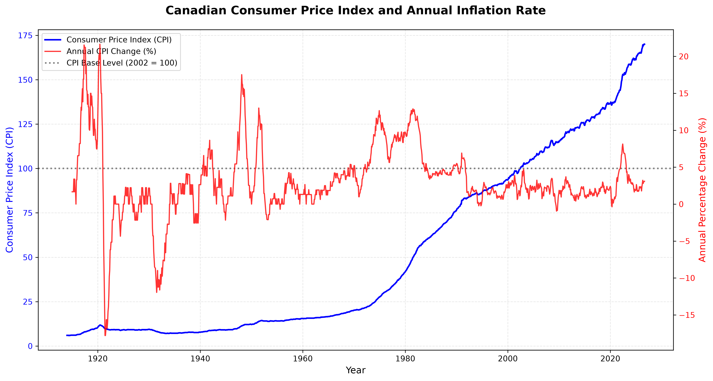

# Canadian CPI Inflation Calculator

## Project Description

This project consists of a Python-based inflation calculator using historical Consumer Price Index (CPI) data provided by the Bank of Canada. The program allows users to enter an original monetary value and select two dates, including a month and year, to calculate how the value has changed due to inflation.

The calculator provides the inflation-adjusted value, total percentage change, difference in years, annualized rate of change, and CPI values for both selected periods. It replicates the main features of the Bank of Canada's calculator but provides more detailed comparisons by allowing users to select specific months and years rather than only years.

The program also includes input validation to ensure users enter valid monetary values and dates within the available dataset. This includes handling dollar signs, commas, negative values, and incorrect date formats.

The project uses **Pandas** to organize and analyze CPI data, **NumPy** for numerical validation, and **Matplotlib** to visualize historical CPI levels and annual inflation rates. A simple menu allows users to run the inflation calculator, generate the CPI graph, or exit the program.

The code follows a modular programming approach through the `InflationCalculator` class, which separates tasks into functions for data processing, input validation, calculations, graphing, and the main menu. This makes the program easier to understand, maintain, and modify.

## Project Files

| File | Description |
|---|---|
| `Assignment2.py` | Main Python program containing the inflation calculator and graphing functions. |
| `STATIC_INFLATIONCALC.csv` | Monthly Canadian CPI data downloaded from the Bank of Canada. |
| `cpi_graph.png` | Graph generated by the program showing historical CPI and annual inflation. |
| `README.md` | Project description, instructions, graph analysis, and sample output. |

## How to Run the Program

1. Download or clone this GitHub repository.
2. Open the project folder in VS Code.
3. Ensure that `Assignment2.py` and `STATIC_INFLATIONCALC.csv` are in the same folder.
4. Install the required Python libraries in the terminal:

   `pip install numpy pandas matplotlib`

5. Run the program:

   `python Assignment2.py`

6. The following menu will appear:

   ```
   Main Menu
   1. Inflation Calculator
   2. Generate CPI Graph
   3. Exit
   ```

7. Select **Option 1** to enter an original monetary value and two dates in `YYYY-MM` format. The calculator will display the adjusted value and inflation statistics.

8. Select **Option 2** to generate the CPI graph. The graph will be displayed and saved as `cpi_graph.png`.

9. Select **Option 3** to exit the program.

## CPI Graph



The graph displays historical Canadian CPI levels and annual inflation rates. The blue line represents CPI values, while the red line shows the annual percentage change compared with the same month in the previous year. The dotted horizontal line represents the CPI base level of 100, with 2002 serving as the base year.

The CPI generally increases over the long term, reflecting an overall rise in Canadian price levels. However, the annual inflation rate is more volatile, with noticeable increases during the 1970s and early 1980s and again around 2022.

An important observation is that even when the inflation rate decreases, CPI can continue to rise. This indicates that prices are increasing at a slower rate rather than necessarily declining.

## Sample Calculator Output

**Example inputs:**

- Original Value: CAD $100.00
- First Date: `2020-01`
- Second Date: `2025-01`

**Example output:**

Paste your actual calculator output from the terminal here after running the example.

The program calculates the inflation-adjusted value using the CPI ratio between the selected dates. It also calculates the total percentage change and the average annualized rate of inflation.

## Data Source

The historical Canadian CPI dataset used in this project was downloaded from the Bank of Canada.

[Bank of Canada — Inflation Calculator](https://www.bankofcanada.ca/rates/related/inflation-calculator/)

[Bank of Canada — Monthly CPI Data (CSV)](https://www.bankofcanada.ca/valet/observations/STATIC_INFLATIONCALC/csv)